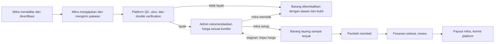

# Business Requirements Document (BRD) — PreCheck

> Platform E-Business Preloved Pakaian Berbasis Konsinyasi dengan Sistem Quality Check (Pre-check)

| Atribut | Isi |
|---|---|
| Versi | 0.3 (DRAFT) |
| Tanggal | 30 Oktober 2026 |
| Dokumen terkait | `docs/business-process.md` v0.4 (proses, aturan bisnis BR-001 s.d. BR-064, asumsi, pertanyaan terbuka), `docs/prd.md` v0.3 |
| Sumber | `DRAFT_PROPOSAL.md`, keputusan Putaran 1 (29 Oktober 2026), arahan revisi 30 Oktober 2026 |
| Stack | Next.js 15 (App Router), Bun (tooling), PostgreSQL (Neon), Drizzle ORM, Auth.js, Tailwind + shadcn/ui, Zod, Vercel (+ Vercel Cron, Vercel Blob), Midtrans sandbox |

Konvensi: `[ASUMSI]` = angka atau keputusan buatan saya yang belum disetujui. `BO` = Business Objective, `BN` = Business Need, `KPI` = indikator keberhasilan, `RSK` = risiko.

**Riwayat revisi v0.3 (30 Oktober 2026):** (1) segmen dipersempit ke **pakaian**; (2) listing **tayang sampai terjual** (tidak ada masa tayang 60 hari); (3) harga **direkomendasikan admin sesuai kondisi barang dan disetujui mitra**. Dampak: masalah M4 dan tujuan BO-007 ditambahkan; KPI-02, KPI-09 diubah, KPI-10 dan KPI-11 ditambahkan; BN-002, BN-007, BN-014 diubah, BN-016 s.d. BN-018 ditambahkan; ekonomi per pesanan dihitung ulang; RSK-13 s.d. RSK-16 ditambahkan. Revisi v0.3: tiga peran admin digabung menjadi satu role ADMIN; kebutuhan, pemangku kepentingan, dan RBAC diselaraskan.

---

## 1. Ringkasan Eksekutif

PreCheck adalah platform web jual beli **pakaian preloved** berbasis **konsinyasi**. Mitra menitipkan pakaian, platform **memeriksa dan mengukur fisik barang**, mencocokkan klaim mitra dengan temuan platform (**double verification**), lalu hanya pakaian yang dinyatakan layak yang diberi **rekomendasi harga sesuai kondisinya**. Setelah mitra menyetujui harga, barang ditayangkan **sampai terjual**. Pembeli melihat foto standar, grade, ukuran aktual, dan ringkasan hasil pemeriksaan sebelum membeli.

Model pendapatan adalah **komisi persentase dari harga jual** (default 20% `[ASUMSI]`). Seluruh ongkir ditanggung mitra (menunggu konfirmasi A-008). Pembayaran dan pengiriman disimulasikan pada fase pengembangan sesuai ruang lingkup proposal.

Keunggulan utama dibanding marketplace umum: keputusan kelayakan dan harga memiliki dasar yang jelas, tercatat, dan dapat ditelusuri (alasan + bukti foto + ukuran terukur).

---

## 2. Latar Belakang dan Peluang Bisnis

1. **Kondisi pasar.** Marketplace umum seperti TikTok Shop memungkinkan penjual mengunggah produk dengan deskripsi dan foto buatan sendiri. Pembeli tidak dapat memeriksa barang sebelum membeli.
2. **Karakter pakaian preloved.** Kondisi tiap potong berbeda (noda, bau, pudar, jahitan, kelengkapan). Ukuran pada label tidak seragam antar merek dan pembeli tidak dapat mencoba sebelum membeli, sehingga informasi dari satu pihak saja meninggalkan keraguan. *(Pengamatan kualitatif; belum diukur dengan data primer. Validasi lewat wawancara pengguna.)*
3. **Harga.** Pada barang bekas, harga seharusnya mengikuti kondisi. Bila penjual menetapkan harga sendiri tanpa acuan kondisi, pembeli sulit menilai kewajaran dan penjual sulit menentukan harga yang laku.
4. **Dasar riset (dari tinjauan pustaka proposal).** Studi terdahulu mengaitkan kualitas layanan e-commerce, keamanan, dan dukungan layanan dengan kepercayaan pengguna platform second-hand (Luo et al., 2020); menunjukkan peran trust dan perceived value pada marketplace sekunder C2C (Moriuchi & Takahashi, 2022); serta menunjukkan pengaruh positif pengakuan pihak ketiga terhadap kepercayaan pada platform, penjual, pembeli, dan produk (Jin & Tsujimoto, 2025). Menurut proposal, studi-studi tersebut belum membahas model konsinyasi dengan pemeriksaan fisik langsung oleh platform. Di situlah celah yang diisi PreCheck. *(Proposal tidak secara khusus membatasi pada pakaian; fokus pakaian adalah keputusan penajaman produk dan perlu dicantumkan pada Bab I proposal.)*
5. **Peluang.** Platform yang memeriksa dan mengukur pakaian sebelum tayang, serta memberi harga yang selaras kondisi, dapat menjadi pihak ketiga yang dipercaya sekaligus memperoleh pendapatan dari komisi.

---

## 3. Masalah dan Tujuan Bisnis

### 3.1 Pernyataan masalah

| Kode | Masalah | Akar masalah | Dampak bisnis |
|---|---|---|---|
| M1 | Belum ada prosedur pemeriksaan sistematis dan pencocokan klaim dengan temuan (proposal 1.2) | Informasi kondisi hanya dari penjual | Keraguan pembeli, konversi rendah |
| M2 | Dokumentasi kondisi fisik terbatas (proposal 1.2) | Foto dibuat sendiri tanpa standar sisi, label, ukuran, dan bagian cacat | Noda dan cacat tidak terlihat, salah ukuran, komplain pasca terima |
| M3 | Proses konsinyasi belum terintegrasi dalam satu platform (proposal 1.2) | Pengajuan, penerimaan, kelayakan, harga, dan penjualan tersebar | Proses lambat, tidak terlacak |
| M4 *(tambahan v0.2, bukan dari proposal)* | Harga barang bekas tidak selaras dengan kondisi | Harga ditetapkan sepihak tanpa acuan grade dan cacat | Barang terlalu mahal (tidak laku) atau terlalu murah (merugikan mitra), kepercayaan harga rendah |

### 3.2 Tujuan bisnis

| ID | Tujuan | Menjawab |
|---|---|---|
| BO-001 | Meningkatkan kepercayaan pembeli terhadap pakaian preloved melalui dokumentasi QC dan ukuran aktual yang terstruktur | M1, M2 |
| BO-002 | Menurunkan ketidaksesuaian antara informasi barang dan kondisi fisik melalui double verification | M1 |
| BO-003 | Mengintegrasikan seluruh proses konsinyasi (pengajuan sampai review) dalam satu platform | M3 |
| BO-004 | Membangun model pendapatan komisi yang menghasilkan kontribusi positif per pesanan | M3 |
| BO-005 | Menjamin kepatuhan hukum dan perlindungan data pribadi mitra dan pembeli | Semua |
| BO-006 | Menjamin akuntabilitas keputusan melalui jejak audit dan pengendalian kewenangan Admin | M1 |
| BO-007 *(baru)* | Menjaga kewajaran harga: harga mengikuti kondisi barang melalui rekomendasi admin yang disetujui mitra, dan ditinjau berkala selama barang tayang | M4 |

### 3.3 Indikator keberhasilan (KPI)

Target di bawah adalah **usulan** `[ASUMSI]` untuk skala demo. Mohon dikoreksi bila ada target dari dosen pengampu (PQ-020).

| KPI | Tujuan | Definisi | Target usulan | Sumber data |
|---|---|---|---|---|
| KPI-01 | BO-002 | Pengajuan dengan QC selesai ≤ 3 hari kerja sejak barang diterima (BR-015) | ≥ 95% | Timestamp status barang |
| KPI-02 *(diubah)* | BO-001 | Listing dengan minimal 5 foto QC, ukuran aktual terisi, dan checklist lengkap (BR-017, BR-057) | 100% | Data listing |
| KPI-03 | BO-002 | Pengajuan dengan ketidaksesuaian klaim vs temuan (LAYAK DENGAN KOREKSI + TIDAK LAYAK karena klaim) | Dipantau, tanpa target | Hasil double verification |
| KPI-04 | BO-001 | Pesanan dengan komplain "tidak sesuai hasil QC" yang terbukti | ≤ 3% | Data komplain |
| KPI-05 | BO-001 | Skor kepercayaan pembeli pada survei pasca transaksi (skala 1–5) | ≥ 4,0 | Survei di UAT |
| KPI-06 | BO-004 | Kontribusi per pesanan (komisi − gateway − biaya QC − pengemasan) | > 0 | Ledger |
| KPI-07 | BO-003 | Pesanan yang diselesaikan tanpa intervensi manual di luar langkah admin yang dirancang | ≥ 90% | Log proses |
| KPI-08 | BO-005 | Temuan keamanan tingkat tinggi pada pengujian sebelum rilis | 0 | Hasil uji keamanan |
| KPI-09 *(diubah)* | BO-003, BO-007 | Umur tayang sampai terjual (median hari) dan proporsi listing yang tayang > 90 hari tanpa terjual | Dipantau, tanpa target | Data listing |
| KPI-10 *(baru)* | BO-007 | Rekomendasi harga awal yang disetujui mitra (tanpa penarikan barang) | ≥ 80% `[ASUMSI]` | Data usulan harga |
| KPI-11 *(baru)* | BO-007 | Rekomendasi harga terkirim ≤ 2 hari kerja sejak barang lolos QC (BR-060) | ≥ 95% | Timestamp status barang |

---

## 4. Ruang Lingkup

### 4.1 Dalam lingkup (versi 1)

- Platform web dengan tiga peran akun: Mitra, Pembeli, dan Admin (ditambah Tamu tanpa akun dan Sistem otomatis).
- Pendaftaran dan verifikasi mitra; pengajuan pakaian; penerimaan; QC dengan dokumentasi foto dan **pengukuran aktual**; **pemeriksaan indikator keaslian (visual)**; double verification; keputusan kelayakan; **rekomendasi harga sesuai kondisi dan persetujuan mitra**; katalog **tayang sampai terjual** dengan **penanda stagnan dan revisi harga**; checkout; pesanan; komplain dan refund; review; komisi dan payout.
- Kategori: **pakaian dewasa** (atasan, bawahan, outerwear, dress, busana muslim, batik, jersey/pakaian olahraga) (A-026).
- Pembayaran (Midtrans sandbox) dan pengiriman **disimulasikan**.

### 4.2 Di luar lingkup (versi 1)

| Item | Alasan |
|---|---|
| Pembayaran uang sungguhan dan integrasi kurir produksi | Proposal 1.6: dapat disimulasikan |
| Sertifikasi keaslian oleh pihak ketiga atau autentikator berlisensi | PreCheck hanya memeriksa indikator visual (A-027, PQ-009) |
| Tas, sepatu, aksesori, elektronik | Penajaman ke pakaian (A-026); dapat menjadi ekspansi |
| Pakaian anak dan bayi | Ditunda (A-026, PQ-024) |
| Penetapan harga otomatis berbasis algoritma atau machine learning | Harga disusun manual oleh Admin berdasarkan pedoman (BR-060) |
| Keranjang multi-barang, wishlist, tawar-menawar pembeli | Stok tiap barang 1; ditunda (PQ-011) |
| Aplikasi mobile native | Proposal: website |
| WhatsApp dan SMS | Menjaga lingkup (PQ-015) |
| Manajemen akun staf melalui UI | Dibuat via seed (A-023) |

---

## 5. Pemangku Kepentingan

| Pemangku kepentingan | Peran dalam proyek | Kepentingan utama | Pengaruh |
|---|---|---|---|
| Mitra/Penjual | Pengguna primer (sisi pasokan) | Pakaian laku dengan payout wajar; harga yang masuk akal dan dapat disetujui; proses titip mudah; keputusan QC transparan | Tinggi |
| Pembeli | Pengguna primer (sisi permintaan) | Pakaian sesuai informasi dan ukuran; harga wajar; perlindungan komplain | Tinggi |
| **Admin** | Pengguna operasional | Mengelola seluruh proses operasional: verifikasi mitra, pre-screening, penerimaan dan QC pakaian, pengukuran, rekomendasi harga, katalog, pesanan, komplain, komisi, payout, refund, dan rekonsiliasi | Sedang |
| Tim pengembang (4 mahasiswa) | Pemilik dan pelaksana proyek | Penyelesaian tepat waktu dan sesuai kriteria penilaian | Tinggi |
| Dosen pengampu (mata kuliah Kapita Selekta SI dan Implementasi SI) | Penilai akademik | Kesesuaian dengan tujuan penelitian dan kualitas rancang bangun | Tinggi |
| Regulator (perlindungan konsumen, PDP, PMSE) | Eksternal | Kepatuhan | Tidak langsung |

---

## 6. Kebutuhan Bisnis

| ID | Kebutuhan bisnis | Tujuan | Aturan bisnis terkait | Prioritas |
|---|---|---|---|---|
| BN-001 | Platform hanya mengizinkan barang berstatus layak, berharga, dan disetujui mitra untuk tayang kepada pembeli | BO-001, BO-002 | BR-020, BR-029, BR-061 | Must |
| BN-002 *(diubah)* | Setiap pakaian diperiksa fisik dengan checklist standar (kain, noda, bau, jahitan, kelengkapan) dan foto dari berbagai sisi termasuk label | BO-001 | BR-016, BR-017, BR-018, BR-022, BR-059 | Must |
| BN-003 | Klaim mitra dicocokkan dengan temuan platform dan hasilnya tercatat per atribut | BO-002 | BR-019, BR-020 | Must |
| BN-004 | Keputusan kelayakan selalu disertai alasan dan bukti, serta dapat ditelusuri | BO-001, BO-006 | BR-021, BR-050 | Must |
| BN-005 | Mitra terverifikasi identitasnya sebelum menitipkan barang | BO-005 | BR-001, BR-002, BR-003 | Must |
| BN-006 | Barang tidak layak dikembalikan kepada mitra dengan alasan dan bukti | BO-001 | BR-023 | Must |
| BN-007 *(diubah)* | Platform merekomendasikan harga jual sesuai kondisi barang; mitra menyetujui, mengajukan satu alternatif, atau menolak; payout dihitung dari harga jual dikurangi komisi dan ongkir | BO-004, BO-007 | BR-025, BR-026, BR-027, BR-043, BR-052, BR-055, BR-060, BR-061 | Must |
| BN-008 | Barang preloved yang unik hanya dapat dibeli oleh satu pembeli; tidak boleh terjadi dua pesanan untuk unit yang sama | BO-003 | BR-030, BR-033, BR-034 | Must |
| BN-009 | Pembeli dapat mengajukan komplain bila barang tidak sesuai hasil QC, dan memperoleh refund penuh bila terbukti | BO-001 | BR-039, BR-045 | Must |
| BN-010 | Setiap pergerakan uang tercatat dan tidak dapat diubah | BO-004, BO-006 | BR-056 | Must |
| BN-011 | Seluruh tindakan Admin memiliki kewenangan yang jelas dan jejak audit agar keputusan dapat ditelusuri | BO-006 | BR-050, BR-053, BR-054 | Must |
| BN-012 | Platform memenuhi ketentuan informasi barang (termasuk klaim keaslian yang tidak menyesatkan), pelindungan data pribadi, dan penyelenggaraan sistem elektronik | BO-005 | BR-005, BR-047, BR-048, BR-049, BR-051, BR-058 | Must |
| BN-013 | Pembeli dapat memberi review dan reputasi mitra ditampilkan | BO-001 | BR-040, BR-041, BR-042 | Should |
| BN-014 *(diubah)* | Proses berbatas waktu (kedaluwarsa pengajuan, reservasi, tanggapan harga, konfirmasi otomatis) dan penanda stagnan berjalan otomatis | BO-003 | BR-012, BR-033, BR-038, BR-061, BR-063 | Must |
| BN-015 | Seluruh antarmuka aksesibel (WCAG 2.1 AA) agar dapat dipakai beragam pengguna | BO-001 | NFR pada PRD dan SRS | Must |
| BN-016 *(baru)* | Setiap pakaian memiliki ukuran aktual terukur yang ditampilkan pada listing sehingga pembeli dapat menilai kecocokan tanpa mencoba | BO-001, BO-002 | BR-057, BR-029, BR-039 | Must |
| BN-017 *(baru)* | Pemeriksaan indikator keaslian dicatat dan ditampilkan dengan redaksi yang jelas lingkupnya (bukan sertifikasi) | BO-001, BO-005 | BR-058, BR-047 | Must |
| BN-018 *(baru)* | Barang tayang sampai terjual, dengan pemantauan listing stagnan dan revisi harga yang memerlukan persetujuan, agar stok tidak menumpuk tanpa tindak lanjut | BO-003, BO-007 | BR-031, BR-062, BR-063 | Must |

---

## 7. Model Bisnis

### 7.1 Ringkasan model (format kanvas)

| Elemen | Isi |
|---|---|
| Segmen pelanggan | **Mitra**: pemilik pakaian preloved yang ingin menjual tanpa mengurus pemasaran dan penentuan harga. **Pembeli**: calon pembeli pakaian bekas yang butuh kepastian kondisi dan ukuran |
| Proposisi nilai | Mitra: titip, tidak perlu memasarkan sendiri, dibantu rekomendasi harga sesuai kondisi. Pembeli: pakaian sudah diperiksa, diukur, difoto standar, diberi grade, dan dijamin refund bila tidak sesuai QC |
| Kanal | Website responsif |
| Hubungan pelanggan | Notifikasi status; laporan QC; rekomendasi harga dengan alasan; layanan komplain |
| Sumber pendapatan | Komisi persentase dari harga jual (default 20%, dapat diatur per kategori) |
| Sumber daya utama | Tim QC, ruang penyimpanan barang, platform web, data hasil QC dan data harga terjual |
| Aktivitas utama | Verifikasi mitra, QC dan pengukuran, double verification, rekomendasi harga, pengelolaan katalog dan listing stagnan, fulfilment, komplain |
| Mitra kunci | Penyedia pembayaran (Midtrans), kurir |
| Struktur biaya | Tenaga QC dan operasional gudang (termasuk penyimpanan barang yang tayang lama), pengemasan, biaya gateway, infrastruktur (Vercel, Neon, Blob), moderasi dan layanan komplain |

### 7.2 Alur nilai tingkat tinggi

Rincian proses, status, dan aturan ada di `docs/business-process.md`.

### 7.3 Ekonomi per pesanan (indikatif, dihitung ulang untuk pakaian)

Seluruh angka `[ASUMSI]` dan hanya untuk menguji kelayakan model, bukan proyeksi keuangan.

| Komponen | Nilai | Catatan |
|---|---|---|
| Harga jual contoh (jaket denim grade B) | Rp250.000 | Disetujui mitra (BR-061) |
| Komisi 20% | Rp50.000 | BR-052 |
| Biaya payment gateway (≈2% harga jual) | −Rp5.000 | Ditanggung platform (BR-044); tarif aktual perlu diverifikasi ke penyedia |
| Biaya QC dan persiapan per barang diproses | Rp12.000 | ≈20 menit petugas: QC, pengukuran, steam, foto |
| Biaya QC per barang terjual | −Rp21.400 | Rp12.000 ÷ 80% lolos QC ÷ 70% akhirnya terjual |
| Pengemasan dan material | −Rp5.000 | |
| **Kontribusi per pesanan** | **≈ Rp18.600** | KPI-06 |

Sensitivitas utama:

- **Harga rendah.** Pada harga jual Rp150.000, komisi Rp30.000 hanya menyisakan ≈Rp600 setelah biaya yang sama. Biaya QC bersifat tetap per barang, sehingga pakaian murah nyaris tidak menghasilkan.
- **Lolos QC dan sell-through.** Bila lolos QC turun ke 60% dan hanya 50% barang akhirnya terjual, biaya QC per barang terjual naik menjadi Rp40.000 dan kontribusi pada harga Rp250.000 turun menjadi ≈Rp0.
- **Tayang sampai terjual.** Tanpa batas masa tayang, proporsi barang yang akhirnya terjual dapat naik, tetapi barang menempati gudang lebih lama (biaya penyimpanan dan perputaran modal tidak termodelkan di tabel ini). Ini dikelola lewat penanda stagnan dan revisi harga (BR-063, BR-062), serta PQ-021.
- **Ongkir.** Tidak memengaruhi pendapatan platform karena ditanggung mitra, tetapi menekan payout dan dapat menurunkan minat mitra (RSK-04), terutama untuk pakaian harga rendah.

Implikasi untuk keputusan: pertimbangkan harga minimum lebih tinggi, komisi bertingkat (mis. persentase lebih tinggi untuk harga rendah), atau biaya QC tetap (PQ-022). Hasil di atas bergantung pada angka asumsi dan perlu divalidasi dengan pengukuran waktu QC nyata saat UAT.

---

## 8. Analisis Kompetitif

| Aspek | TikTok Shop (pembanding proposal) | PreCheck |
|---|---|---|
| Model | Marketplace | Konsinyasi dengan QC |
| Sumber informasi kondisi | Penjual | Mitra + pemeriksaan fisik platform |
| Dokumentasi | Foto dan informasi penjual | Foto QC standar: depan, belakang, label, detail, cacat |
| Ukuran | Ukuran label dari penjual | Ukuran label + ukuran aktual terukur platform |
| Keaslian | Klaim penjual | Indikator keaslian diperiksa visual (bukan sertifikasi) |
| Syarat tayang | Tidak ada pemeriksaan fisik platform | Wajib dinyatakan layak |
| Barang bermasalah | Tidak ada alur khusus | Dikembalikan dengan alasan dan bukti |
| Harga | Ditentukan penjual | Direkomendasikan platform sesuai grade dan kondisi, disetujui mitra |
| Masa tayang | Dikelola penjual | Sampai terjual, dipantau lewat penanda stagnan |

Catatan: proposal hanya membandingkan dengan satu kompetitor yang bersifat marketplace umum. Karena fokus kini pakaian preloved, pertimbangkan menambah pembanding yang khusus pakaian atau barang preloved (misalnya Prelo atau Carousell) dan memverifikasi fitur terbaru mereka dari sumber resmi sebelum dicantumkan.

---

## 9. Kepatuhan dan Kebijakan

| Area | Kewajiban bisnis | Aturan |
|---|---|---|
| Perlindungan konsumen | Informasi barang benar, jelas, jujur; barang ditandai bekas; cacat diungkapkan; **klaim keaslian tidak menyesatkan** | BR-047, BR-058 (UU 8/1999) |
| Pelindungan data pribadi | Persetujuan, pembatasan akses, retensi untuk KTP, selfie, alamat, rekening | BR-005, BR-048, BR-049 (UU 27/2022) |
| Penyelenggara sistem elektronik perdagangan | Identitas pelaku usaha, syarat dan ketentuan | BR-051 (PP 80/2019) |
| Kebijakan internal | Kebijakan QC (apa yang diperiksa dan tidak, termasuk batas indikator keaslian), pengukuran, rekomendasi harga, retur, komplain, kategori terlarang, dan moderasi dipublikasikan | BR-009, BR-039, BR-058 |

Rujukan peraturan perlu diverifikasi ke sumber resmi sebelum dijadikan dasar formal pada laporan.

---

## 10. Risiko Bisnis

Skala: Kemungkinan (K) dan Dampak (D) = Rendah / Sedang / Tinggi.

| ID | Risiko | K | D | Mitigasi |
|---|---|---|---|---|
| RSK-01 | **Kekurangan pasokan** (sedikit mitra mau menitip) membuat katalog sepi | S | T | Onboarding mitra sederhana; payout transparan; mulai dari subkategori terbatas |
| RSK-02 | **QC menjadi bottleneck** saat volume naik (kini ditambah pengukuran) | S | T | Batas pengajuan aktif per mitra (BR-010); SLA QC (BR-015); antrean dan dashboard QC; pedoman titik ukur ringkas |
| RSK-03 | **Inkonsistensi penilaian QC** antar petugas | S | T | Checklist dan grade baku (BR-016, BR-018); pedoman material vs non-material; pengendalian akses dan jejak audit |
| RSK-04 | **Ongkir menggerus payout** sehingga mitra enggan menitip (lebih terasa pada pakaian harga rendah) | T | S | Estimasi payout pada setiap rekomendasi (BR-026); harga minimum dan payout > 0 (BR-055); konfirmasi aturan ongkir (A-008) |
| RSK-05 | **Mitra tidak jujur** (barang tiruan, kondisi dibohongi) | S | T | Verifikasi identitas (BR-002); double verification; indikator keaslian (BR-058); suspensi (BR-004); pernyataan tertulis (BR-008) |
| RSK-06 | **Barang rusak atau hilang** saat pengiriman atau di gudang | S | S | Catat kondisi kemasan saat terima (BR-014); foto sebelum kirim; kebijakan komplain |
| RSK-07 | **Kebocoran data KTP dan selfie** | R | T | Akses terbatas (BR-005); enkripsi dan penyimpanan privat; audit log (BR-050); retensi |
| RSK-08 | **Dua pembeli memesan unit yang sama** | S | T | Reservasi dengan penguncian baris dan constraint unik (lihat PRD bagian 13) |
| RSK-09 | **Salah hitung uang** (komisi, payout, refund) | S | T | Ledger tak-ubah (BR-056); uji dengan skenario tabel alur uang; rekonsiliasi |
| RSK-10 | **Klaim keaslian dianggap jaminan** padahal hanya pemeriksaan indikator visual; potensi sengketa dan masalah perlindungan konsumen | S | T | Redaksi jelas "indikator keaslian, bukan sertifikat" (BR-058); kebijakan QC dipublikasikan; opsi "tidak dapat dipastikan"; pertimbangkan rujukan pihak ketiga di masa depan (PQ-009) |
| RSK-11 | **Ketergantungan simulasi** menutupi masalah integrasi nyata | S | S | Rancang antarmuka pembayaran dan pengiriman sebagai adapter; uji dengan sandbox Midtrans |
| RSK-12 | **Tenggat proyek** terlalu ketat untuk cakupan modul yang luas | T | T | Prioritas Must/Should (PRD); rilis bertahap; konfirmasi tenggat (PQ-019) |
| RSK-13 *(baru)* | **Margin tipis pada pakaian harga rendah** karena biaya QC tetap per barang | T | T | Harga minimum dan komisi bertingkat (PQ-022); ukur waktu QC nyata; checklist efisien |
| RSK-14 *(baru)* | **Stok menumpuk** karena tayang sampai terjual tanpa batas: gudang penuh, modal tertahan, katalog penuh barang lama | S | S | Penanda stagnan 30/60/90 hari (BR-063); revisi harga dengan persetujuan (BR-062); mitra dapat menarik barang (BR-028); batas penyimpanan atau biaya penyimpanan bila perlu (PQ-021) |
| RSK-15 *(baru)* | **Rekomendasi harga ditolak mitra** atau berlarut, sehingga barang yang sudah di-QC dikembalikan dan biaya terbuang | S | S | Pedoman harga transparan dengan alasan (BR-060); satu putaran alternatif (BR-061); batas respons 3 hari; harga harapan mitra sebagai masukan awal (BR-064); pantau KPI-10 |
| RSK-16 *(baru)* | **Pengukuran tidak konsisten** antar petugas sehingga ukuran aktual tidak dapat dipercaya dan memicu komplain | S | S | Pedoman titik ukur per subkategori dengan gambar; foto pengukuran wajib; toleransi dan aturan komplain ukuran (BR-057, BR-039); alat ukur standar |

---

## 11. Asumsi, Batasan, dan Ketergantungan

| Jenis | Isi |
|---|---|
| Batasan teknis | Stack tetap sesuai tabel di awal dokumen; runtime produksi Vercel adalah Node.js (Bun hanya untuk tooling lokal/CI, mengikuti Nokoribite) |
| Batasan ruang lingkup | Pembayaran dan pengiriman disimulasikan (proposal 1.6); hanya pakaian dewasa |
| Asumsi bisnis | Komisi 20%; harga jual minimum Rp50.000; seluruh ongkir ditanggung mitra (A-008, **menunggu konfirmasi**); **tayang sampai terjual** (A-032); **harga direkomendasikan admin dan disetujui mitra dalam 3 hari** (A-031); pedoman rentang harga per grade (A-030); refund penuh dengan jendela komplain 2x24 jam |
| Asumsi operasional | Satu gudang; platform memegang barang dan mengirim ke pembeli (A-017); perlakuan platform hanya steam ringan (A-029) |
| Ketergantungan | Midtrans sandbox; penyedia email transaksional (belum dipilih, Resend atau setara `[ASUMSI]`); Vercel Blob untuk foto; Vercel Cron untuk job terjadwal |
| Pertanyaan terbuka | A-008, A-027; PQ-008 s.d. PQ-025 pada `business-process.md` |

Catatan teknis yang memengaruhi bisnis: batas frekuensi Vercel Cron bergantung pada paket yang dipakai (paket gratis dibatasi lebih ketat). Aturan waktu PreCheck berskala jam dan hari sehingga tidak butuh interval detik, tetapi batas paket aktual perlu dicek sebelum Sprint dengan job terjadwal.

---

## 12. Rencana Tingkat Tinggi

Urutan mengikuti pola Sprint pada proyek Nokoribite. Durasi dan jumlah anggota `[ASUMSI]` (sprint mingguan, 4 anggota) sampai PQ-019 dijawab.

| Sprint | Fokus | Hasil utama |
|---|---|---|
| 0 | Discovery dan setup | BRD, PRD, SRS, sitemap dan brief Figma, repo Next.js + Bun + Neon, skema Drizzle awal |
| 1 | Desain dan fondasi | Komponen Figma (aksesibilitas), Auth.js dengan RBAC 3 peran (MITRA, PEMBELI, ADMIN), audit log |
| 2 | Modul Mitra | Registrasi, verifikasi identitas, pengajuan pakaian (ukuran, label, foto), pre-screening |
| 3 | Modul QC | Penerimaan, QC workspace pakaian, pengukuran aktual, indikator keaslian, double verification, keputusan, retur barang |
| 4 | Harga dan katalog | Rekomendasi harga dengan pedoman dan kalkulator payout, tanggapan mitra (setuju/alternatif/tolak), listing, katalog dengan filter ukuran dan detail produk dengan laporan QC |
| 5 | Transaksi | Checkout dan reservasi (harga terkunci), Midtrans sandbox, pesanan dan fulfilment, job terjadwal (kedaluwarsa, penanda stagnan) |
| 6 | Komplain, uang, review, revisi harga | Komplain dan refund, ledger, payout, review, revisi harga saat tayang, dashboard Admin |
| 7 | UAT dan hardening | Skenario UAT per peran, audit WCAG 2.1 AA, uji konkurensi reservasi, uji keamanan |
| 8 | Deploy dan serah terima | Produksi di Vercel, smoke test, dokumentasi |

---

## 13. Keterlacakan Masalah → Tujuan → Kebutuhan → Aturan

| Masalah | Tujuan | Kebutuhan | Aturan bisnis |
|---|---|---|---|
| M1 | BO-001, BO-002, BO-006 | BN-001, BN-003, BN-004, BN-011, BN-017 | BR-019 s.d. BR-021, BR-029, BR-050, BR-053, BR-058 |
| M2 | BO-001 | BN-002, BN-006, BN-009, BN-015, BN-016 | BR-016 s.d. BR-018, BR-022, BR-023, BR-029, BR-039, BR-057, BR-059 |
| M3 | BO-003, BO-004 | BN-005, BN-007, BN-008, BN-010, BN-013, BN-014, BN-018 | BR-001 s.d. BR-004, BR-025 s.d. BR-028, BR-030 s.d. BR-046, BR-052 s.d. BR-056, BR-063 |
| M4 | BO-007, BO-004 | BN-007, BN-018 | BR-025 s.d. BR-027, BR-055, BR-060 s.d. BR-062, BR-064 |
| (lintas) | BO-005 | BN-012 | BR-005, BR-047 s.d. BR-051 |

Setiap BR pada `business-process.md` akan dipetakan ke minimal satu FR atau NFR pada SRS (Fase 1).

---

## 14. Persetujuan

| Peran | Nama | Status | Tanggal |
|---|---|---|---|
| Ketua kelompok | | Menunggu | |
| Anggota kelompok | | Menunggu | |
| Dosen pengampu | | Menunggu | |

Dokumen ini berstatus DRAFT sampai A-008 dan A-027 dikonfirmasi dan pertanyaan Putaran 2 dan 2b dijawab.
