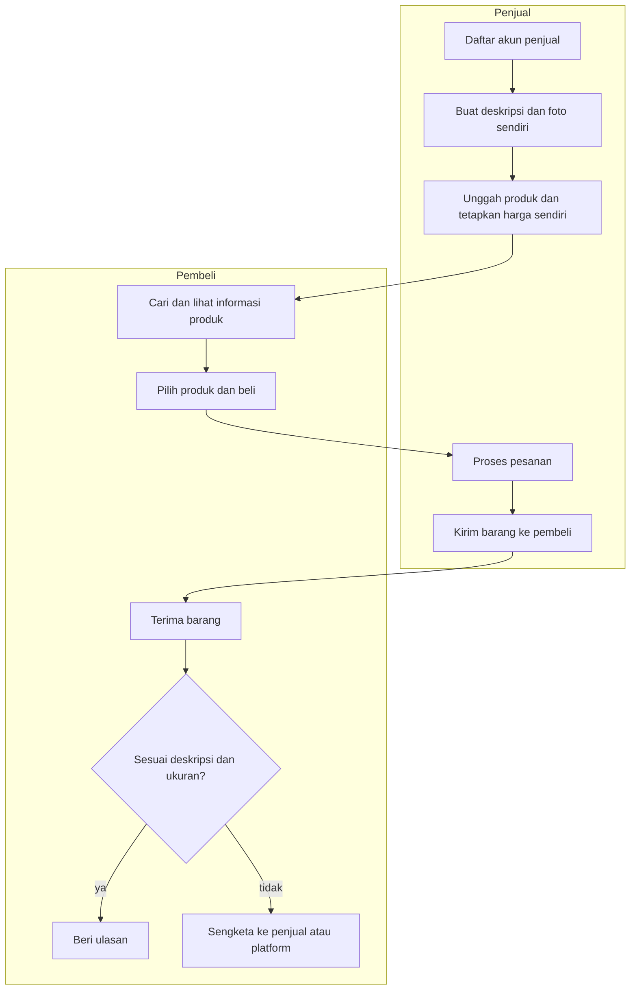
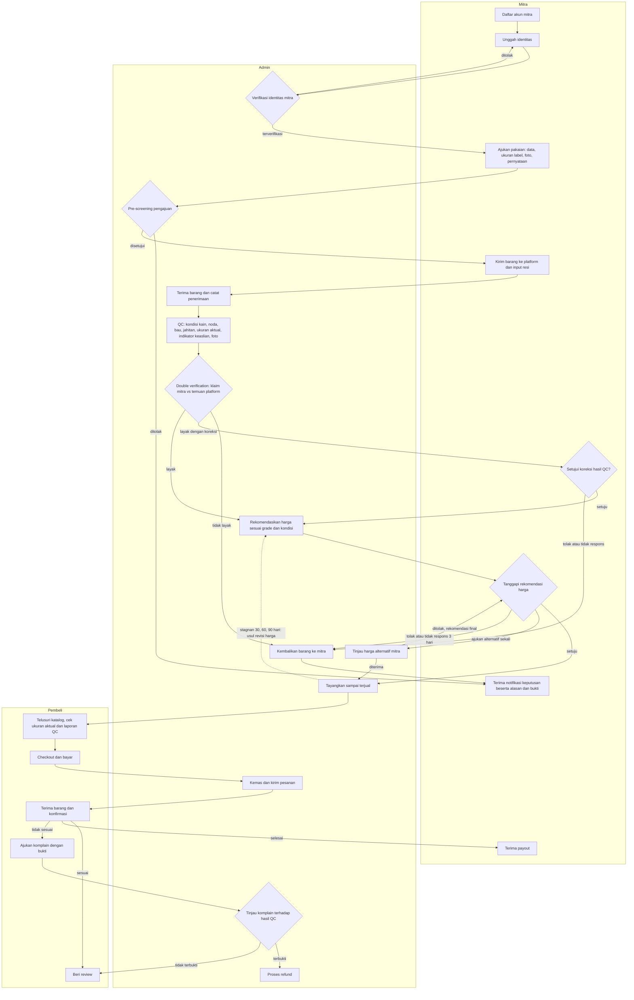
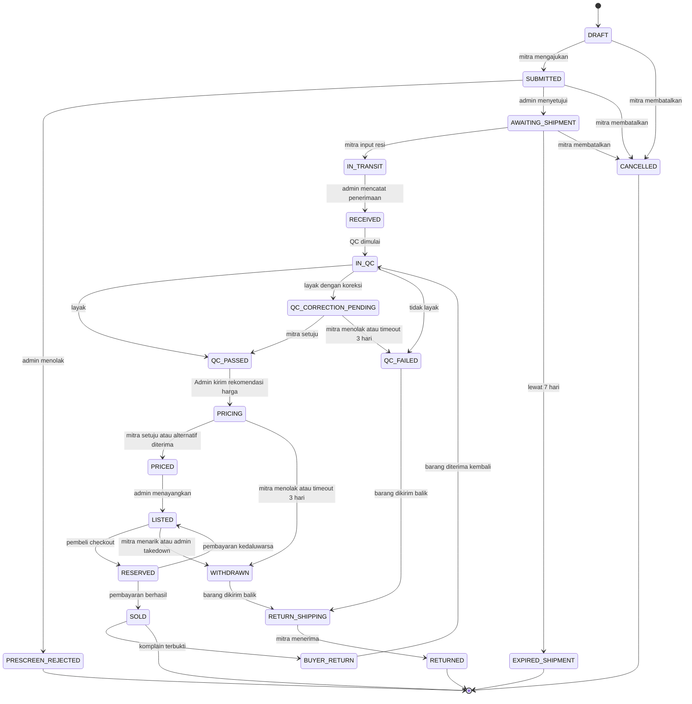
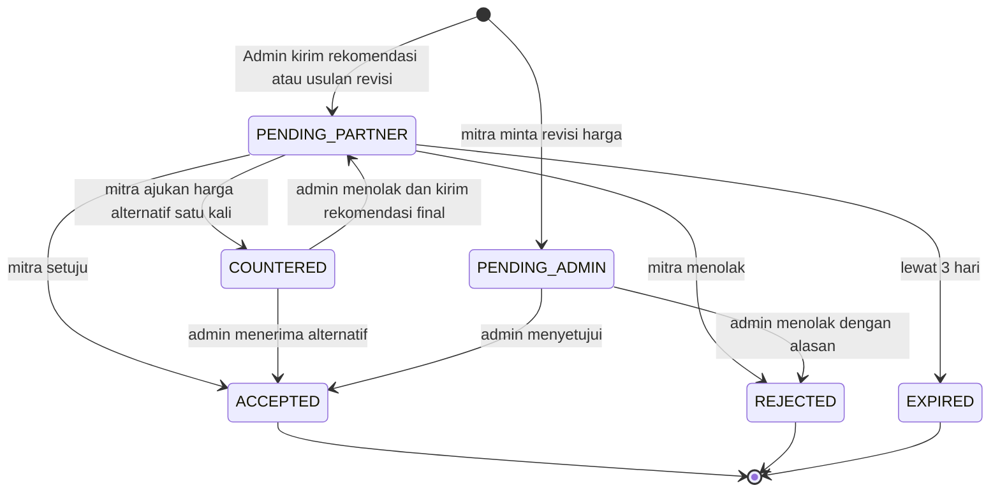
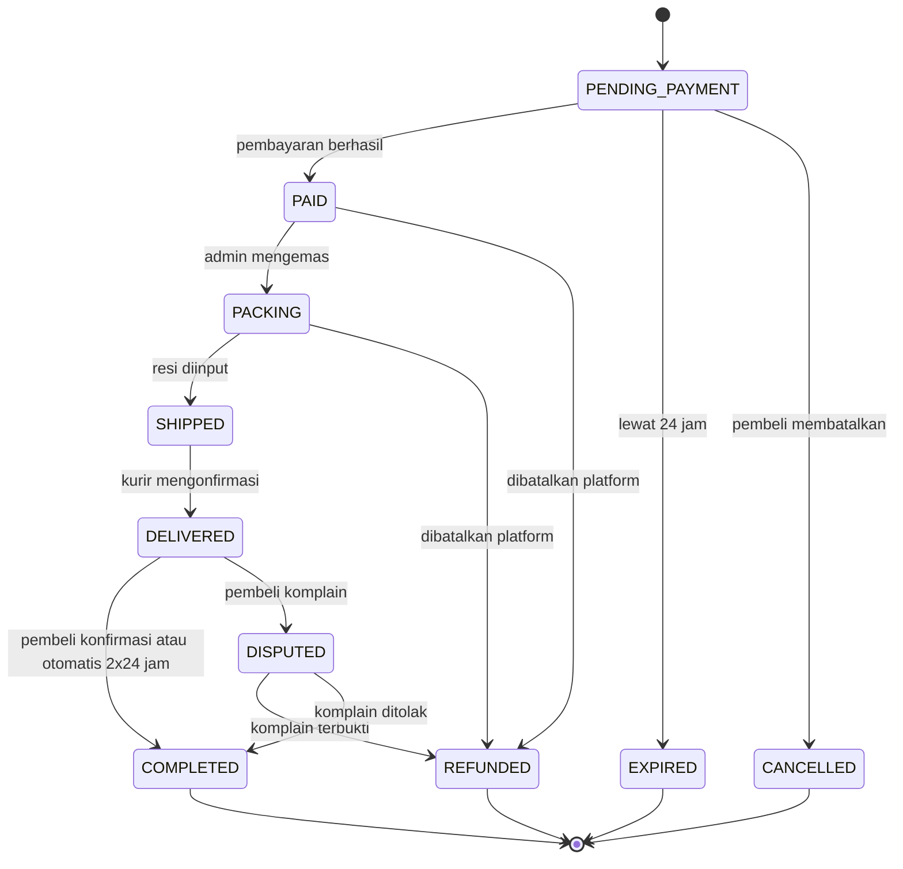
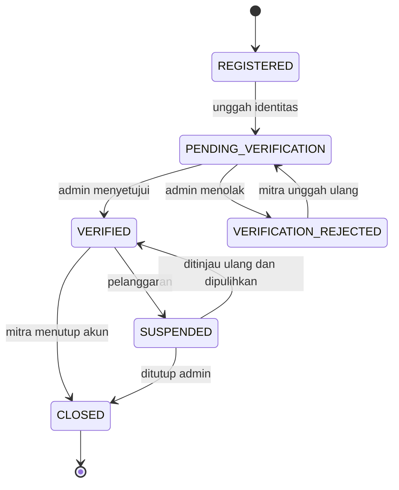
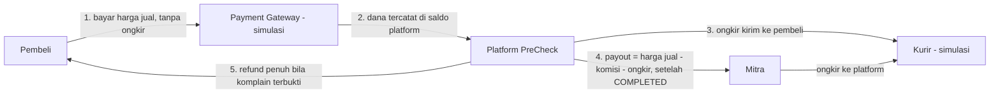

# Business Process — PreCheck

> Platform E-Business Preloved Pakaian Berbasis Konsinyasi dengan Sistem Quality Check (Pre-check)

| Atribut | Isi |
|---|---|
| Fase | 0 — Analisis proses bisnis (bukan SRS) |
| Status | **DRAFT — Revisi 30 Oktober 2026 (fokus pakaian, tayang sampai terjual, harga berbasis rekomendasi admin, dan satu role Admin). Menunggu konfirmasi A-008 dan A-026 s.d. A-033, Putaran 2, dan kata "APPROVED"** |
| Versi | 0.4 |
| Tanggal | 30 Oktober 2026 |
| Sumber | `DRAFT_PROPOSAL.md` (Bab I–III; subbab 3.2–3.4 pada proposal masih kosong), keputusan Putaran 1 (29 Oktober 2026), arahan revisi 30 Oktober 2026 |
| Stack tetap | Next.js 15 (App Router), Bun, PostgreSQL (Neon), Drizzle ORM, Auth.js, Tailwind + shadcn/ui, Vercel |

Konvensi penandaan:

- `[ASUMSI]` = keputusan sementara yang saya buat karena proposal atau arahan tidak menyebutnya. Daftar lengkap ada di bagian 7.
- `[PQ-nnn]` = aturan atau proses yang bergantung pada jawaban pertanyaan terbuka di bagian 8.
- ID aturan: `BR-nnn`. ID asumsi: `A-nnn`. ID pertanyaan: `PQ-nnn`.
- **(direvisi v0.3)** = aturan lama yang isinya berubah. **(baru v0.3)** = aturan baru. Nomor BR lama dipertahankan agar keterlacakan ke BRD dan PRD tidak putus.

---

## Riwayat Revisi

| Versi | Tanggal | Perubahan |
|---|---|---|
| 0.2 | 29 Okt 2026 | Putaran 1 terjawab (komisi, ongkir, kategori, peran admin). |
| 0.3 | 30 Okt 2026 | (1) Segmen produk dipersempit ke **pakaian** (A-026): kategori, checklist QC, foto, dan katalog disesuaikan; ditambah pengukuran aktual dan pemeriksaan indikator keaslian. (2) Listing **tayang sampai terjual** (BR-031 diganti; status `LISTING_EXPIRED` dihapus; ditambah penanda stagnan BR-063). (3) Harga **direkomendasikan Admin sesuai kondisi barang dan disetujui mitra** (BR-025 s.d. BR-028 diubah; BR-060 s.d. BR-062 dan BR-064 baru; status `PRICING` baru). (4) Turunan: A-026 s.d. A-033, PQ-021 s.d. PQ-025, diagram, alur uang. |
| 0.4 | 30 Okt 2026 | Tiga peran admin (QC, Katalog & Harga, Keuangan) digabung menjadi satu aktor dan role `ADMIN`; BR-053, BR-054, A-023, PQ-007, matriks akses, dan seluruh penyebutan peran diselaraskan. |

---

## 0. Ringkasan Konteks

| Item | Isi |
|---|---|
| Nama proyek | PreCheck |
| Jenis platform | Marketplace terkurasi berbasis konsinyasi untuk **pakaian preloved** dengan quality check (Pre-check) |
| Masalah yang diselesaikan | (1) Tidak ada prosedur pemeriksaan sistematis untuk menilai kelayakan pakaian preloved, termasuk pencocokan klaim mitra dengan kondisi fisik. (2) Dokumentasi kondisi fisik dan hasil pemeriksaan terbatas, ukuran tidak seragam antar merek, sehingga pembeli sulit menilai kesesuaian produk. (3) Proses konsinyasi (pengajuan, penerimaan, kelayakan, harga, penjualan) belum terintegrasi dalam satu platform. (4) *Tambahan hasil revisi:* harga barang bekas sering tidak berkaitan dengan kondisi aktual. |
| Pengguna utama | Mitra/Penjual, Admin/Platform, Pembeli |
| Batasan proposal | Website; tiga aktor utama; setiap barang wajib QC dan double verification sebelum tayang; **pengiriman dan pembayaran dapat disimulasikan** |
| Diferensiasi | Pakaian tidak langsung tayang. Barang dikirim ke platform, diperiksa dan diukur, diverifikasi dua tahap, dinyatakan layak, diberi **rekomendasi harga sesuai kondisi yang disetujui mitra**, lalu tayang **sampai terjual** |

---

## 1. Aktor dan Peran

| Aktor | Tipe | Peran | Aktivitas utama |
|---|---|---|---|
| **Mitra/Penjual** | Primer | Pemilik pakaian yang menitipkan ke platform | Registrasi dan verifikasi identitas; mengajukan pakaian (data, foto, label, pernyataan); mengirim barang; menerima keputusan QC; menyetujui atau menolak koreksi; **menanggapi rekomendasi harga (setuju, ajukan alternatif sekali, tolak)**; menyetujui atau mengusulkan revisi harga; menarik barang; menerima payout |
| **Admin** | Primer | Pengelola seluruh operasional platform | Verifikasi identitas mitra dan pre-screening; mencatat penerimaan; QC, **pengukuran aktual**, **pemeriksaan indikator keaslian**, foto dokumentasi, double verification, dan keputusan kelayakan; rekomendasi dan revisi harga; pengelolaan katalog; pengemasan dan retur fisik; penanganan komplain dan moderasi; pengaturan komisi, verifikasi pembayaran, payout, refund, rekonsiliasi, dan ledger |
| **Pembeli** | Primer | Pihak yang membeli pakaian yang telah lolos QC | Menelusuri dan membandingkan katalog (termasuk ukuran aktual); checkout; bayar; konfirmasi terima; komplain; beri review |
| **Tamu (pengunjung)** | Primer (varian Pembeli) | Pengunjung tanpa akun | Menelusuri katalog dan melihat hasil QC; harus login untuk checkout `[ASUMSI A-009]` |
| **Sistem (cron/worker)** | Sistem | Proses otomatis terjadwal | Kedaluwarsa pengajuan, reservasi, dan usulan harga; penanda stagnan 30/60/90 hari; konfirmasi otomatis pesanan; pengingat; notifikasi |
| **Kurir** | Eksternal (simulasi) | Pengiriman mitra→platform, platform→pembeli, retur | Simulasi pembaruan status pengiriman `[ASUMSI A-007]` |
| **Payment Gateway** | Eksternal (simulasi) | Pembayaran pembeli dan payout mitra | Simulasi pembayaran dan webhook status `[ASUMSI A-006]` |

---

## 2. Proses As-Is dan To-Be

### 2.1 Proses As-Is — Marketplace Umum (pembanding: TikTok Shop)

Berdasarkan subbab 3.1.2 proposal: penjual membuat informasi produk sendiri dan produk langsung tampil. Pemeriksaan fisik oleh platform bukan tahapan utama.

Titik masalah as-is yang relevan:

| Kode | Titik masalah | Dampak ke pembeli |
|---|---|---|
| P1 | Kondisi barang hanya berasal dari klaim penjual | Informasi bisa tidak lengkap atau bias |
| P2 | Foto dibuat sendiri oleh penjual, tanpa standar sisi dan bagian cacat | Noda, pudar, atau cacat lain dapat tidak terlihat |
| P3 | Tidak ada pencocokan klaim terhadap kondisi fisik sebelum tayang | Ketidaksesuaian baru terdeteksi setelah barang diterima |
| P4 | Kelayakan barang tidak menjadi syarat tayang | Barang bermasalah tetap dapat dijual |
| P5 | *(tambahan v0.3)* Ukuran label tidak seragam antar merek dan jarang disertai ukuran aktual | Pembeli tidak bisa mencoba; risiko salah ukuran |
| P6 | *(tambahan v0.3)* Harga ditetapkan penjual tanpa acuan kondisi | Harga tidak wajar bagi pembeli atau merugikan penjual |

### 2.2 Proses To-Be — PreCheck

Alur utama dari registrasi mitra sampai review pembeli, termasuk jalur barang tidak layak, jalur koreksi, jalur rekomendasi harga, tayang sampai terjual, dan jalur komplain.

Perbandingan as-is dan to-be (turunan dari tabel 3.1.3 proposal, diperbarui v0.3):

| Aspek | As-Is (marketplace umum) | To-Be (PreCheck) | Menjawab |
|---|---|---|---|
| Pengajuan barang | Penjual mengunggah langsung | Mitra mengajukan, lalu mengirim fisik ke platform | P3, P4 |
| Sumber informasi kondisi | Penjual saja | Mitra + hasil pemeriksaan platform (double verification) | P1, P3 |
| Dokumentasi | Foto penjual | Foto QC standar: depan, belakang, label, detail, close-up cacat | P2 |
| Ukuran | Ukuran label dari penjual | Ukuran label + **ukuran aktual terukur** oleh platform | P5 |
| Keaslian merek | Klaim penjual | **Indikator keaslian diperiksa visual** (bukan sertifikasi pihak ketiga) | P1 |
| Syarat tayang | Tidak ada | Wajib dinyatakan layak | P4 |
| Barang tidak layak | Tidak ada alur khusus | Dikembalikan dengan alasan dan bukti | P4 |
| Penentuan harga | Penjual | **Platform merekomendasikan sesuai grade dan kondisi; mitra menyetujui** | P6 |
| Masa tayang | Dikelola penjual | **Sampai terjual**, dipantau lewat penanda stagnan | — |
| Peran platform | Menyediakan sarana | Menerima, memeriksa, menilai, merekomendasikan harga, mengelola produk, mendukung transaksi | — |

---

## 3. Business Rules

Kolom **Sumber**: `P` = tersurat di proposal, `A` = asumsi saya (ditandai `[ASUMSI]`), `L` = rujukan hukum, `R` = arahan revisi 30 Oktober 2026.

### 3.1 Akun dan Verifikasi Mitra

| ID | Aturan | Sumber |
|---|---|---|
| BR-001 | Hanya mitra yang identitasnya telah diverifikasi admin yang dapat mengajukan barang. | P (verifikasi mitra mencakup identitas) |
| BR-002 | Verifikasi mitra memerlukan: nama lengkap, NIK, foto KTP, foto selfie dengan KTP, nomor telepon, alamat, dan rekening atau e-wallet tujuan payout. `[ASUMSI A-001]` `[PQ-008]` | A |
| BR-003 | Satu NIK hanya dapat terdaftar pada satu akun mitra. | A |
| BR-004 | Mitra berstatus SUSPENDED tidak dapat mengajukan barang baru. Barang yang sudah dalam proses tetap diselesaikan atau dikembalikan. | A |
| BR-005 | Data identitas mitra hanya dapat dilihat oleh admin berwenang dan tidak ditampilkan publik. | L (UU PDP) |

### 3.2 Pengajuan Barang

| ID | Aturan | Sumber |
|---|---|---|
| BR-006 **(direvisi v0.3)** | Satu pengajuan = satu potong pakaian (kuantitas 1). Setelan yang hanya dijual sepaket (mis. kemeja dan celana) diajukan sebagai satu barang dan seluruh potongannya diperiksa. `[ASUMSI A-002]` `[ASUMSI A-026]` | A |
| BR-007 **(direvisi v0.3)** | Data wajib pengajuan: subkategori, nama, merek, **ukuran pada label, bahan/komposisi (bila tertera), warna**, deskripsi kondisi, kelengkapan (tag, aksesori bawaan), daftar cacat yang diketahui (noda, bau, lubang, pudar, jahitan, ritsleting, kancing) atau pernyataan tidak ada cacat, dan **minimal 4 foto mandiri** (depan, belakang, label merek/ukuran, dan cacat bila ada). Ukuran aktual yang diukur mitra bersifat opsional tetapi disarankan. | P (informasi kondisi dari mitra) + A (jumlah foto) + R |
| BR-008 | Mitra wajib menyatakan secara eksplisit bahwa informasi kondisi dan kebersihan benar dan bahwa barang adalah miliknya yang sah (termasuk bahwa barang bukan tiruan sepengetahuan mitra). Persetujuan disimpan dengan waktu dan versi teks pernyataan. | P (pernyataan mitra) + A |
| BR-009 **(direvisi v0.3)** | **Dalam lingkup: pakaian dewasa** — atasan (kaos, kemeja, blus, sweater, hoodie), bawahan (celana, jeans, rok), outerwear (jaket, blazer, cardigan), terusan/dress, busana muslim, batik, dan jersey/pakaian olahraga. **Tidak dapat diajukan:** pakaian dalam, kaus kaki, pakaian renang, masker, seragam instansi atau atribut aparat, pakaian anak dan bayi (ditunda, A-026), barang tiruan atau palsu, serta barang yang pelarangannya diatur hukum. Barang non-pakaian (tas, sepatu, aksesori, elektronik) di luar lingkup versi 1. Daftar final mengikuti `[PQ-004]`. | A + L + R |
| BR-010 | Mitra maksimal memiliki 10 pengajuan aktif (belum berstatus final) pada saat bersamaan. `[ASUMSI A-003]` | A |
| BR-011 | Setiap pengajuan melalui pre-screening oleh Admin maksimal 2 hari kerja (memeriksa subkategori dalam lingkup, kejelasan foto, kelengkapan data). Disetujui → mitra mendapat instruksi pengiriman. Ditolak → disertai alasan. `[ASUMSI A-004]` | A |
| BR-012 | Mitra wajib mengirim barang dan menginput resi maksimal 7 hari kalender sejak pengajuan disetujui. Lewat batas → pengajuan kedaluwarsa otomatis. | A |
| BR-013 | Mitra dapat mengubah atau membatalkan pengajuan selama barang belum berstatus IN_TRANSIT. | A |

### 3.3 Penerimaan, Quality Check, dan Double Verification

| ID | Aturan | Sumber |
|---|---|---|
| BR-014 | Saat paket tiba, admin mencocokkan dengan kode pengajuan dan mencatat tanggal terima serta kondisi kemasan. Paket tanpa kode atau tidak cocok dicatat sebagai anomali dan dihubungi ke mitra. | A |
| BR-015 | QC harus selesai maksimal 3 hari kerja setelah barang diterima. | A |
| BR-016 **(direvisi v0.3)** | Checklist QC pakaian wajib mencakup: kondisi kain (pudar, melar, bulu halus/pilling, menipis), **noda**, **bau**, lubang atau sobek, jahitan, ritsleting/kancing/karet (bila ada), kelengkapan (tag, aksesori), kebersihan, dan kesesuaian dengan deskripsi mitra. | P + R |
| BR-017 **(direvisi v0.3)** | Dokumentasi QC wajib memuat foto: depan, belakang, label merek, label ukuran/komposisi, dan foto ukuran (datar dengan alat ukur), ditambah foto close-up untuk setiap cacat atau kondisi khusus (minimal 5 foto per barang). Foto QC (bukan foto mitra) menjadi foto utama pada katalog. | P (sisi foto) + A + R |
| BR-018 **(direvisi v0.3)** | Hasil QC diberi grade kondisi: **A** (sangat baik: hampir seperti baru, tanpa noda atau cacat, bentuk dan warna terjaga); **B** (baik: tanda pemakaian ringan seperti sedikit pudar atau pilling ringan, tanpa cacat mencolok); **C** (layak dengan cacat jelas dan terungkap, mis. noda kecil permanen, jahitan terlepas kecil, pudar nyata, namun tetap layak pakai). Di bawah C = tidak layak (mis. noda besar menetap, bau menyengat yang tidak hilang, sobek besar, jamur, kerusakan struktur). `[ASUMSI A-005]` | A + R |
| BR-019 **(direvisi v0.3)** | Double verification dilakukan pada setiap barang di akhir QC: tahap 1 = pernyataan mitra, tahap 2 = temuan fisik platform. Hasil pencocokan dicatat per atribut (sesuai / tidak sesuai): merek, ukuran label, bahan, warna, kondisi, cacat, kelengkapan, ukuran aktual (bila diisi mitra), dan indikator keaslian. | P |
| BR-020 **(direvisi v0.3)** | Keputusan QC hanya salah satu dari: **LAYAK**, **LAYAK DENGAN KOREKSI** (ketidaksesuaian non-material, mis. warna sedikit berbeda, bahan tertulis keliru, selisih ukuran kecil, cacat kecil yang tidak dilaporkan; deskripsi dikoreksi platform), atau **TIDAK LAYAK** (ketidaksesuaian material, mis. merek berbeda dari klaim, indikasi tidak asli, noda atau bau besar yang tidak diungkap, ukuran label salah jauh). Batas material dan non-material ditetapkan dalam pedoman QC. `[ASUMSI A-010]` | P + A |
| BR-021 | Setiap keputusan wajib memiliki alasan tertulis dan bukti foto, serta tercatat siapa pengambil keputusan dan kapan. Keputusan tanpa jejak tidak dapat disimpan. | P (alasan dan bukti) |
| BR-022 **(direvisi v0.3)** | Pemeriksaan tambahan per subkategori: jaket, jeans, dan celana → fungsi ritsleting, kancing, karet/tali; blazer dan outerwear → lapisan dalam dan bantalan bahu; sweater dan knit → pilling, melar, lubang; busana muslim dan batik → kain tipis/menerawang, kerapian jahitan, pudar warna; jersey dan pakaian olahraga → sablon/logo retak atau mengelupas. Daftar final mengikuti `[PQ-004]`. | P (persyaratan tambahan untuk kategori tertentu) + R |
| BR-023 | Barang TIDAK LAYAK dikembalikan ke mitra maksimal 7 hari kerja setelah keputusan, dengan notifikasi alasan dan bukti. Barang tidak boleh dijual atau dimusnahkan tanpa persetujuan mitra. `[PQ-001]` `[PQ-013]` | P + A |
| BR-024 | Pada LAYAK DENGAN KOREKSI, mitra diberi 3 hari kalender untuk menyetujui. Setuju → lanjut ke rekomendasi harga. Menolak atau tidak merespons → diperlakukan sebagai TIDAK LAYAK. `[ASUMSI A-010]` `[PQ-002]` | A |
| BR-057 **(baru v0.3)** | **Pengukuran aktual.** Petugas QC mengukur dimensi pakaian sesuai subkategori (mis. atasan: lebar dada, panjang, lebar bahu, panjang lengan; bawahan: lingkar pinggang, panjang, panjang dalam/inseam, lebar paha; dress: lebar dada, lingkar pinggang, panjang) dan membandingkannya dengan ukuran label serta ukuran dari mitra. Selisih melebihi toleransi (default ±2 cm) dicatat sebagai ketidaksesuaian. Hasil ukuran ditampilkan pada listing. `[ASUMSI A-028]` `[PQ-023]` | R + A |
| BR-058 **(baru v0.3)** | **Indikator keaslian.** Untuk barang bermerek, petugas QC memeriksa indikator visual (label, jahitan, tag, kode produksi, kualitas sablon) dan mencatat hasil: *indikator terpenuhi*, *tidak dapat dipastikan*, atau *terindikasi tidak asli*. Terindikasi tidak asli → TIDAK LAYAK. Pemeriksaan ini **bukan sertifikasi atau jaminan keaslian dari pihak ketiga**; redaksi di katalog harus menjelaskan lingkupnya. `[ASUMSI A-027]` `[PQ-009]` | R + A + L |
| BR-059 **(baru v0.3)** | **Perlakuan platform.** Penilaian grade dan cacat dilakukan pada kondisi barang saat diterima. Platform hanya melakukan perlakuan ringan (steam, lint roller) untuk keperluan foto katalog; perlakuan dicatat dan tidak mengubah hasil penilaian. Pencucian penuh tidak dilakukan. `[ASUMSI A-029]` | A |

### 3.4 Penetapan Harga (diubah menjadi rekomendasi harga sesuai kondisi)

| ID | Aturan | Sumber |
|---|---|---|
| BR-025 **(direvisi v0.3)** | Harga jual **direkomendasikan** oleh Admin setelah barang dinyatakan layak (QC_PASSED) dan baru menjadi harga jual setelah **disetujui mitra** (BR-061). Mitra tidak menetapkan harga sendiri, tetapi berhak menyetujui, mengajukan satu harga alternatif, atau menolak. Nilai untuk mitra (payout) tidak diinput, melainkan dihitung dari harga jual dikurangi komisi dan ongkir (BR-052, BR-046). | P + A + R |
| BR-026 | Setiap barang memiliki **harga jual** (dibayar pembeli) dan **perkiraan payout mitra** = harga jual − komisi − ongkir kirim ke pembeli. Semua nominal dalam Rupiah, bilangan bulat, lebih dari 0. Perkiraan payout ditampilkan kepada mitra pada setiap rekomendasi dan revisi harga, sebelum disetujui. | P + A |
| BR-027 **(direvisi v0.3)** | Rekomendasi harga disusun berdasarkan **kondisi barang**: grade, jenis dan tingkat cacat, kelengkapan (tag), merek, ukuran aktual dan bahan, tren/kelangkaan, harga baru referensi, dan harga barang serupa yang pernah terjual di platform. Setiap rekomendasi dan revisi dicatat: nilai, alasan, pelaku, tanggapan mitra, dan waktu. | P + A + R |
| BR-028 **(direvisi v0.3)** | Mitra dapat meminta penarikan barang kapan saja selama status LISTED dan belum direservasi, tanpa biaya penarikan (ongkir retur mengikuti BR-046). Tidak ada tawar-menawar antara pembeli dan platform atau mitra. Satu-satunya negosiasi yang diizinkan adalah antara Admin dan mitra pada BR-061 dan BR-062. `[ASUMSI A-011]` | A + R |
| BR-055 | Harga jual minimum Rp50.000 dan perkiraan payout harus lebih dari 0 setelah komisi dan ongkir; rekomendasi, harga alternatif, dan revisi yang tidak memenuhi syarat tidak dapat disimpan. `[PQ-022]` | A |
| BR-060 **(baru v0.3)** | **Pedoman dan SLA rekomendasi harga.** Admin memakai pedoman rentang harga sebagai titik awal, yaitu persentase dari harga baru referensi: grade A 50–70%, grade B 35–50%, grade C 15–35% `[ASUMSI A-030]`. Penyimpangan dari rentang wajib disertai alasan. Rekomendasi dikirim maksimal 2 hari kerja setelah QC_PASSED dan memuat: harga jual, rincian komisi, ongkir, perkiraan payout, grade, cacat utama, dan alasan. | R + A |
| BR-061 **(baru v0.3)** | **Tanggapan mitra atas rekomendasi awal.** Mitra memiliki 3 hari kalender (pengingat H-1) untuk: (a) **setuju** → barang PRICED; (b) **mengajukan satu harga alternatif** → Admin menerima (PRICED) atau menolak dengan alasan dan mengirim rekomendasi final, yang hanya dapat disetujui atau ditolak mitra; (c) **menolak** atau tidak merespons → barang WITHDRAWN dan dikembalikan (ongkir retur mengikuti BR-046). Harga alternatif tunduk pada BR-055. `[ASUMSI A-031]` | R + A |
| BR-062 **(baru v0.3)** | **Revisi harga saat tayang.** Revisi dapat diusulkan Admin (mis. barang stagnan, BR-063) atau mitra. Usulan admin memerlukan persetujuan mitra; usulan mitra memerlukan persetujuan Admin. Harga lama tetap berlaku sampai usulan disetujui. Usulan yang tidak ditanggapi dalam 3 hari kalender kedaluwarsa dan harga lama tetap berlaku (listing tidak diturunkan). **Harga dikunci saat reservasi**: revisi yang disetujui saat barang RESERVED baru berlaku bila barang kembali LISTED. Tarif komisi tetap (BR-052); nominal komisi dihitung ulang dari harga baru. `[ASUMSI A-034]` | R + A |
| BR-064 **(baru v0.3)** | **Harga harapan mitra (opsional).** Pada pengajuan, mitra boleh mengisi harga harapan. Nilai ini hanya masukan bagi Admin, tidak mengikat, dan tidak ditampilkan publik. `[ASUMSI A-033]` | A |

### 3.5 Katalog dan Stok

| ID | Aturan | Sumber |
|---|---|---|
| BR-029 **(direvisi v0.3)** | Hanya barang berstatus layak, sudah berharga, dan harganya disetujui mitra yang tampil di katalog. Setiap listing menampilkan: foto QC dari berbagai sisi (depan, belakang, label, detail, cacat), subkategori, merek, **ukuran label dan ukuran aktual (cm)**, bahan, warna, deskripsi kondisi, kelengkapan, grade, ringkasan hasil QC dan cacat, **hasil indikator keaslian beserta penjelasan lingkupnya**, status kelayakan, dan penanda bahwa barang adalah preloved. | P + L + R |
| BR-030 | Stok setiap barang adalah 1. Satu barang hanya dapat dibeli oleh satu pembeli. | A |
| BR-031 **(diganti v0.3)** | Listing **tayang sampai terjual**: tetap berstatus LISTED hingga SOLD, ditarik mitra (BR-028), atau diturunkan admin (BR-032). Tidak ada masa tayang atau kedaluwarsa listing. Pemantauan listing yang lama tidak laku dilakukan lewat penanda stagnan (BR-063). `[ASUMSI A-032]` `[PQ-021]` | R |
| BR-032 | Admin dapat menurunkan listing bila ada pelanggaran atau laporan valid, dengan alasan yang tercatat. Bila akun mitra ditutup (CLOSED), barang LISTED ditarik dan dikembalikan. | A |
| BR-063 **(baru v0.3)** | **Penanda stagnan.** Sistem menandai listing yang belum pernah direservasi selama 30, 60, dan 90 hari sejak tayang atau sejak revisi harga terakhir `[ASUMSI A-032]`. Setiap penanda membuat tugas bagi Admin untuk meninjau dan mengusulkan revisi harga (BR-062) serta mengirim notifikasi ke mitra tentang pilihan menyetujui revisi atau menarik barang. Penanda tidak menurunkan listing. | R + A |

### 3.6 Transaksi dan Pesanan

| ID | Aturan | Sumber |
|---|---|---|
| BR-033 | Saat checkout, barang direservasi untuk pembeli selama 24 jam menunggu pembayaran. Lewat batas → pesanan EXPIRED dan barang kembali LISTED. `[ASUMSI A-013]` | A |
| BR-034 | Barang yang sedang direservasi tidak dapat dibeli pembeli lain. Sistem harus mencegah dua pembeli memesan unit yang sama pada waktu bersamaan. Harga pada pesanan adalah harga saat reservasi (BR-062). | A |
| BR-035 | Mitra tidak dapat membeli barang miliknya sendiri. | A |
| BR-036 | Pembayaran disimulasikan melalui mode sandbox. Status pembayaran diperbarui melalui callback simulasi. `[ASUMSI A-006]` | P (simulasi) |
| BR-037 | Setelah pembayaran sukses, platform mengemas dan memasukkan resi maksimal 2 hari kerja. Status pengiriman disimulasikan. `[ASUMSI A-007]` | P + A |
| BR-038 | Pesanan berstatus COMPLETED saat pembeli mengonfirmasi terima, atau otomatis 2x24 jam setelah DELIVERED bila tidak ada komplain. `[ASUMSI A-014]` | A |
| BR-039 **(direvisi v0.3)** | Pembeli dapat mengajukan komplain maksimal 2x24 jam setelah DELIVERED dengan bukti foto atau video. Admin memutuskan dengan membandingkan bukti pembeli terhadap hasil QC (termasuk ukuran aktual). Tidak sesuai hasil QC (mis. noda atau cacat tidak terungkap, ukuran aktual berbeda dari laporan, bau, terbukti tidak asli) → refund penuh dan barang diretur. Sesuai hasil QC → komplain ditolak. **Ketidakcocokan ukuran dengan tubuh pembeli bukan dasar komplain bila ukuran aktual pada laporan QC benar.** `[ASUMSI A-014]` `[PQ-005]` | A + R |

### 3.7 Review

| ID | Aturan | Sumber |
|---|---|---|
| BR-040 | Review hanya dapat dibuat oleh pembeli yang pesanannya COMPLETED, satu review per pesanan, dalam 30 hari setelah COMPLETED. Format: rating 1–5 dan teks. | P (review setelah transaksi selesai) + A |
| BR-041 | Review dapat dimoderasi admin (spam, SARA, data pribadi). Mitra tidak dapat menghapus review. | A |
| BR-042 | Karena stok tiap barang 1, review melekat pada pesanan dan diagregasi pada profil mitra (reputasi), bukan hanya pada barang. `[ASUMSI A-015]` `[PQ-010]` | A |

### 3.8 Uang dan Biaya

| ID | Aturan | Sumber |
|---|---|---|
| BR-043 | Payout ke mitra dilakukan setelah pesanan COMPLETED dan melewati masa tunggu komplain. Payout = harga jual − komisi − ongkir kirim ke pembeli − potongan piutang mitra (bila ada). Barang konsinyasi tidak dibayarkan ke mitra sebelum terjual. | A |
| BR-044 | Pendapatan platform = komisi (BR-052). Biaya payment gateway ditanggung platform dari komisi. Ongkir diteruskan ke kurir dan bukan pendapatan platform. `[ASUMSI A-022]` | A |
| BR-045 | Refund pembeli dilakukan penuh atas harga jual (pembeli tidak membayar ongkir, sehingga tidak ada ongkir yang dikembalikan). Karena payout hanya setelah COMPLETED, refund tidak memerlukan penarikan dana dari mitra. Ongkir retur akibat komplain `[PQ-018]`. | A |
| BR-046 | Seluruh ongkos kirim ditanggung mitra: ongkir mitra→platform dibayar mitra langsung; ongkir retur barang tidak layak, barang ditarik (termasuk karena menolak rekomendasi harga), dan ongkir platform→pembeli dipotong dari payout, atau dicatat sebagai piutang mitra bila tidak ada payout yang dapat dipotong. Pembeli tidak membayar ongkir. `[ASUMSI A-008]` `[ASUMSI A-024]` | A |

### 3.9 Kepatuhan Hukum dan Audit

| ID | Aturan | Sumber |
|---|---|---|
| BR-047 **(direvisi v0.3)** | Informasi barang harus benar, jelas, dan jujur; barang wajib ditandai sebagai bekas, seluruh cacat yang diketahui diungkapkan, dan **klaim keaslian tidak boleh menyesatkan** (hanya menyatakan hasil pemeriksaan indikator, BR-058). | L (UU 8/1999 Perlindungan Konsumen) |
| BR-048 | Pengelolaan data pribadi (KTP, selfie, alamat, rekening) harus berdasarkan persetujuan pengguna, pembatasan akses, dan hak penghapusan sesuai ketentuan. | L (UU 27/2022 PDP) |
| BR-049 | Bukti QC, pernyataan mitra, dan data transaksi disimpan minimal 2 tahun. `[ASUMSI A-016]` | A |
| BR-050 | Seluruh tindakan admin yang mengubah status barang, harga, keputusan QC, komplain, dan payout dicatat dalam audit log (pelaku, waktu, nilai sebelum dan sesudah). | A |
| BR-051 | Platform beroperasi sebagai penyelenggara sistem elektronik perdagangan dan wajib menampilkan identitas pelaku usaha serta syarat dan ketentuan layanan. | L (PP 80/2019 PMSE) |

> **Catatan hukum:** rujukan UU 8/1999, UU 27/2022, dan PP 80/2019 saya cantumkan sebagai arah kepatuhan. Verifikasi pasal dan ketentuan terbaru ke sumber resmi sebelum dijadikan dasar formal di laporan.

### 3.10 Komisi, Peran Admin, dan Pengendalian

| ID | Aturan | Sumber |
|---|---|---|
| BR-052 | Komisi platform dihitung sebagai persentase dari harga jual (default 20%, dapat diatur per kategori oleh Admin). Tarif disalin ke barang saat berstatus LISTED dan tidak berubah untuk barang tersebut. `[ASUMSI A-022]` | A |
| BR-053 **(direvisi)** | Tidak ada pemisahan akun Admin berdasarkan fungsi QC, katalog/harga, atau keuangan. Satu akun **ADMIN** memiliki kewenangan untuk menjalankan seluruh fungsi operasional. Setiap tindakan penting tetap wajib mencatat pelaku, waktu, objek, alasan, dan perubahan data pada audit log (BR-050); keputusan QC dan komplain tetap wajib disertai alasan serta bukti sesuai aturan terkait. | R (permintaan penyatuan peran Admin) + A |
| BR-054 **(direvisi)** | Hak akses role **ADMIN** mencakup seluruh fungsi internal platform: verifikasi mitra, pre-screening, penerimaan barang, QC, pengukuran, pemeriksaan indikator keaslian, double verification, keputusan QC, pengemasan dan retur fisik, rekomendasi dan revisi harga, pengelolaan katalog, tindak lanjut listing stagnan, moderasi, keputusan komplain, pengaturan komisi, verifikasi pembayaran, payout, refund, rekonsiliasi, ledger, dan audit log. Fungsi-fungsi tersebut dapat dikelompokkan dalam modul/halaman berbeda, tetapi bukan role atau akun yang terpisah. | R + A |
| BR-056 | Semua pergerakan uang (pembayaran, komisi, payout, refund, piutang) dicatat pada ledger yang tidak dapat diubah; koreksi dilakukan dengan entri baru, bukan edit. | A |

---

## 4. Siklus Hidup Entitas Utama

### 4.1 Barang (Item) — dari pengajuan sampai terjual atau kembali

Perubahan v0.3: `LISTING_EXPIRED` dihapus (tayang sampai terjual); `PRICED` kini didahului status `PRICING` (rekomendasi harga menunggu tanggapan mitra). Revisi harga saat LISTED tidak mengubah status barang; prosesnya dilacak pada siklus usulan harga (4.1a).

Tabel transisi rinci (guard, aktor, efek) akan dibuat di SRS (Fase 1).

### 4.1a Usulan Harga (Price Proposal)

Satu barang memiliki paling banyak satu usulan terbuka pada satu waktu. Berlaku untuk rekomendasi awal (barang PRICING) dan revisi saat LISTED.

| Konteks | ACCEPTED | REJECTED atau EXPIRED |
|---|---|---|
| Rekomendasi awal (barang PRICING) | Barang PRICED, siap ditayangkan | Barang WITHDRAWN dan dikembalikan (BR-061) |
| Revisi saat LISTED | Harga baru berlaku (atau setelah reservasi selesai, BR-062) | Harga lama tetap; listing tetap tayang |

Pada rekomendasi final (setelah COUNTERED ditolak) mitra tidak dapat mengajukan alternatif lagi.

### 4.2 Pesanan (Order)

### 4.3 Akun Mitra

---

## 5. Alur Uang

Pembayaran dan payout bersifat **simulasi** (BR-036), dengan Midtrans mode sandbox. Model pendapatan: **komisi persentase dari harga jual** (PQ-001). Harga jual adalah harga yang telah disetujui mitra (BR-061, BR-062). Seluruh ongkir ditanggung mitra (A-008, menunggu konfirmasi), sehingga pembeli membayar harga jual saja.

| Skenario | Pembeli | Platform | Mitra |
|---|---|---|---|
| Penjualan normal | Bayar harga jual | Terima dana; tahan sampai COMPLETED; tahan komisi sebagai pendapatan | Terima payout = harga jual − komisi − ongkir ke pembeli |
| Barang tidak layak | — | Tidak ada pendapatan | Bayar ongkir ke platform; ongkir retur menjadi piutang mitra |
| Mitra menolak rekomendasi harga *(baru v0.3)* | — | Tidak ada pendapatan | Bayar ongkir ke platform; ongkir retur menjadi piutang mitra |
| Komplain terbukti | Refund penuh harga jual | Tidak ada pendapatan; barang diretur dan di-QC ulang | Tidak ada payout; ongkir menjadi piutang `[PQ-018]` |
| Pembayaran kedaluwarsa | Tidak ada dana berpindah | — | — |
| Barang ditarik mitra | — | Tidak ada pendapatan | Bayar ongkir ke platform; ongkir retur menjadi piutang mitra |

Contoh ilustrasi pakaian (angka hanya contoh, bukan ketentuan):

| Komponen | Nominal |
|---|---|
| Harga jual yang disetujui mitra (grade B, jaket denim) | Rp250.000 |
| Komisi platform 20% | Rp50.000 |
| Ongkir ke pembeli (ditanggung mitra) | Rp15.000 |
| **Payout mitra** | **Rp185.000** |
| Pendapatan platform sebelum biaya gateway dan operasional | Rp50.000 |

Konsekuensi yang perlu diperhatikan: harga pakaian preloved umumnya rendah, sehingga ongkir menggerus payout lebih besar secara proporsional. Pada harga Rp80.000 dengan ongkir Rp15.000, payout hanya Rp49.000 (sekitar 61% dari harga jual). Estimasi payout pada setiap rekomendasi harga (BR-026) dan harga minimum (BR-055) menjadi pengaman; keduanya perlu ditinjau lagi untuk pakaian `[PQ-022]`.

---

## 6. Ringkasan Pemetaan Masalah ke Proses

Untuk memudahkan traceability matrix di Fase 1.

| Masalah | Proses To-Be yang menjawab | Business rule terkait |
|---|---|---|
| Belum ada prosedur pemeriksaan sistematis dan pencocokan klaim mitra | QC terstruktur + double verification | BR-016, BR-018, BR-019, BR-020, BR-021, BR-058 |
| Dokumentasi kondisi fisik dan ukuran terbatas | Foto QC standar, ukuran aktual, ringkasan hasil di katalog | BR-017, BR-029, BR-057 |
| Proses konsinyasi belum terintegrasi | Alur pengajuan → penerimaan → kelayakan → rekomendasi harga → katalog → transaksi → review | BR-001 s.d. BR-064 |
| *(tambahan v0.3)* Harga tidak selaras kondisi | Rekomendasi harga berbasis grade dan kondisi, disetujui mitra, ditinjau berkala | BR-025 s.d. BR-028, BR-060 s.d. BR-064 |

---

## 7. Daftar Asumsi

| ID | Asumsi | Dasar | Terkait |
|---|---|---|---|
| A-001 | Verifikasi mitra memakai KTP + selfie dengan KTP, diperiksa manual oleh admin. | Proposal hanya menyebut "identitas". | BR-002 |
| A-002 | Kuantitas tiap pengajuan = 1 unit. | Karakter barang preloved. | BR-006, BR-030 |
| A-003 | Batas pengajuan aktif per mitra = 10. | Perlu kuota agar beban QC terkendali. | BR-010 |
| A-004 | Ada pre-screening admin sebelum mitra mengirim barang. | Proposal tidak menyebut tahap ini. | BR-011 |
| A-005 | Grade kondisi A/B/C; di bawah C tidak layak (definisi untuk pakaian pada BR-018). | Proposal hanya menyebut layak/tidak layak. | BR-018 |
| A-006 | Pembayaran dan payout disimulasikan (sandbox atau mock), tanpa uang sungguhan. | Ruang lingkup proposal 1.6. | BR-036 |
| A-007 | Pengiriman disimulasikan: resi diinput manual dan status diubah oleh admin atau simulator. | Ruang lingkup proposal 1.6. | BR-037 |
| A-008 | Jawaban "mitra yang tanggung" untuk PQ-003 ditafsirkan sebagai mitra menanggung **seluruh** ongkir (ke platform, retur, dan ke pembeli); pembeli mendapat gratis ongkir. **Mohon dikonfirmasi.** | Jawaban pengguna + tafsiran saya | BR-046 |
| A-009 | Tamu dapat melihat katalog dan hasil QC tanpa login; checkout memerlukan akun. | Praktik umum e-commerce. | Aktor |
| A-010 | Ada tiga keputusan QC; koreksi memerlukan persetujuan mitra dalam 3 hari. | Proposal hanya menyebut layak dan tidak layak. | BR-020, BR-024 |
| A-011 | Mitra dapat menarik barang selama LISTED dan belum direservasi. | Hak dasar pemilik barang konsinyasi. | BR-028 |
| A-012 | ~~Masa tayang katalog 60 hari.~~ **Dibatalkan v0.3**, digantikan A-032. | Arahan revisi 30 Okt 2026 | BR-031 |
| A-013 | Batas bayar 24 jam sejak checkout. | Praktik umum. | BR-033 |
| A-014 | Konfirmasi otomatis dan jendela komplain = 2x24 jam setelah DELIVERED. | Proposal tidak menyebut retur dan komplain. | BR-038, BR-039 |
| A-015 | Review melekat pada pesanan dan diagregasi ke reputasi mitra. | Stok 1. | BR-042 |
| A-016 | Retensi bukti QC dan transaksi 2 tahun. | Proposal tidak menyebut. | BR-049 |
| A-017 | Platform memegang barang di gudang sendiri dan mengirim langsung ke pembeli. | Proposal 1: barang "tetap berada di pihak platform". | Seluruh alur |
| A-018 | Foto disimpan pada object storage (mis. Vercel Blob). | Kebutuhan foto QC. | NFR Fase 1 |
| A-019 | Job terjadwal (kedaluwarsa pengajuan, reservasi, usulan harga, penanda stagnan, konfirmasi otomatis, pengingat) memakai Vercel Cron. | Stack Vercel. | Fase 1 |
| A-020 | Notifikasi lewat email dan notifikasi dalam aplikasi; WhatsApp di luar lingkup. | Menjaga lingkup kecil. `[PQ-015]` | Fase 1 |
| A-021 | Mata uang IDR, zona waktu WIB, bahasa antarmuka Bahasa Indonesia, cakupan wilayah Indonesia. | Konteks proyek. | Fase 1 |
| A-022 | Komisi platform 20% dari harga jual, dapat diatur per kategori; harga jual minimum Rp50.000. | Jawaban PQ-001 (b) | BR-052, BR-055 |
| A-023 **(direvisi)** | Hanya ada satu role admin, yaitu ADMIN; akun staf dibuat lewat seed. Satu role ini mencakup fungsi QC, katalog/harga, dan keuangan. | Arahan revisi: seluruh peran admin digabung menjadi satu | BR-053, BR-054 |
| A-024 | Mitra memiliki ledger saldo; piutang mitra dipotong dari payout berikutnya. | Konsekuensi BR-046 | BR-043, BR-046, BR-056 |
| A-025 | Default diterima untuk PQ-002 dan PQ-005. PQ-004 (kategori) dan PQ-006 (masa tayang) **digantikan oleh arahan 30 Okt 2026** (A-026, A-032). | Jawaban pengguna | BR-009, BR-022, BR-028, BR-031, BR-039 |
| **A-026** | **Fokus produk = pakaian dewasa** (atasan, bawahan, outerwear, dress, busana muslim, batik, jersey). Pakaian anak/bayi ditunda; tas, sepatu, aksesori, dan elektronik di luar lingkup versi 1. | Arahan 30 Okt 2026 + tafsiran saya untuk rincian subkategori | BR-006, BR-009, BR-022 |
| **A-027** | Pre-check mencakup **pemeriksaan indikator keaslian secara visual** untuk barang bermerek, bukan sertifikasi pihak ketiga. Ini mengubah default PQ-009 sebelumnya ("tidak ada pemeriksaan keaslian"). **Mohon dikonfirmasi.** | Deskripsi Pre-check pada arahan (verifikasi keaslian dan kondisi) + tafsiran saya | BR-058, BR-047 |
| **A-028** | Pengukuran aktual wajib untuk setiap pakaian; toleransi selisih default ±2 cm; titik ukur per subkategori ditetapkan pada pedoman QC. | Ukuran adalah sumber ketidakpastian utama pembelian pakaian online | BR-057 |
| **A-029** | Platform melakukan perlakuan ringan (steam, lint roller) hanya untuk foto katalog; tidak mencuci. Penilaian pada kondisi saat diterima. | Menjaga objektivitas QC dan biaya rendah | BR-059 |
| **A-030** | Pedoman rekomendasi harga: grade A 50–70%, B 35–50%, C 15–35% dari harga baru referensi. Angka awal untuk diuji dan dikalibrasi. | Tafsiran saya atas arahan "harga sesuai kondisi" | BR-060 |
| **A-031** | Mitra menanggapi rekomendasi dalam 3 hari kalender: setuju, satu harga alternatif, atau tolak. Tidak respons = menolak; barang dikembalikan dengan ongkir retur ditanggung mitra. | Arahan "rekomendasi admin ke mitra" ditafsirkan sebagai persetujuan mitra diperlukan | BR-061 |
| **A-032** | Tayang sampai terjual tanpa batas waktu dan tanpa biaya penyimpanan. Penanda stagnan pada hari ke-30, 60, 90 memicu tinjauan harga, bukan penurunan otomatis. | Arahan 30 Okt 2026 + angka pemantauan dari saya | BR-031, BR-063 |
| **A-033** | Harga harapan mitra bersifat opsional dan tidak mengikat. | Membantu rekomendasi dan mengelola ekspektasi | BR-064 |
| **A-034** | Revisi harga saat tayang memerlukan persetujuan pihak lawan (mitra untuk usulan admin, admin untuk usulan mitra); harga dikunci saat reservasi. | Menjaga keadilan konsinyasi dan mencegah sengketa harga | BR-062 |

---

## 8. Pertanyaan Terbuka

Kolom **Default** adalah yang saya pakai bila tidak dijawab.

### Putaran 1 — Terjawab (29 Oktober 2026)

| ID | Pertanyaan | Keputusan | Dampak |
|---|---|---|---|
| PQ-001 | Model pendapatan dan payout | **(b) Komisi persentase dari harga jual** | BR-025, BR-026, BR-043, BR-044, BR-052; A-022 |
| PQ-002 | Hak mitra setelah QC dan harga | Default diterima: boleh menarik selama LISTED, tanpa biaya | BR-028 (diperluas v0.3) |
| PQ-003 | Ongkos kirim | "Mitra yang tanggung", ditafsirkan sebagai seluruh ongkir. **Mohon konfirmasi (A-008)** | BR-046 |
| PQ-004 | Kategori barang | ~~Fashion, tas, sepatu, elektronik kecil~~ → **Pakaian** (arahan 30 Okt 2026) | BR-009, BR-022; A-026 |
| PQ-005 | Retur dan komplain | Default diterima: refund penuh, komplain maksimal 2x24 jam | BR-039, BR-045 |
| PQ-006 | Masa tayang | ~~60 hari~~ → **sampai terjual** (arahan 30 Okt 2026) | BR-031; A-032 |
| PQ-007 | Peran Admin dan pre-screening | **Satu role Admin** untuk QC, Katalog & Harga, dan Keuangan; pre-screening tetap ada | BR-011, BR-053, BR-054 |

### Arahan Revisi — Terjawab (30 Oktober 2026)

| Arahan | Penerapan | Perlu konfirmasi |
|---|---|---|
| Fokus segmen ke pakaian | BR-006, BR-007, BR-009, BR-016 s.d. BR-018, BR-022, BR-029, BR-057 s.d. BR-059 | Rincian subkategori (PQ-004, PQ-024) |
| Tayang katalog sampai sold out | BR-031 diganti, BR-063 baru, `LISTING_EXPIRED` dihapus | Batas penyimpanan dan biaya (PQ-021) |
| Harga sesuai kondisi atas rekomendasi admin ke mitra | BR-025 s.d. BR-028, BR-060 s.d. BR-062, BR-064, status `PRICING` | Mitra boleh menolak/mengajukan alternatif? (A-031); angka pedoman (A-030) |

### Putaran 2 — Detail operasional

| ID | Pertanyaan | Default |
|---|---|---|
| PQ-008 | Seberapa ketat verifikasi identitas mitra (KTP + selfie manual, atau cukup data diri)? Apakah rekening payout wajib saat registrasi? | A-001 |
| PQ-009 *(diperbarui)* | Apakah pemeriksaan keaslian cukup indikator visual internal (label, jahitan, tag, kode produksi), atau perlu rujukan pihak ketiga? Bagaimana redaksi klaim di katalog agar tidak menyesatkan? | A-027: visual internal, redaksi "indikator keaslian", bukan sertifikat |
| PQ-010 | Review ditujukan ke siapa: barang, mitra, atau platform? | A-015 |
| PQ-011 | Apakah pembeli dapat membeli lebih dari satu barang sekaligus (keranjang)? Wishlist atau tawar-menawar? | Tanpa keranjang; satu pesanan = satu barang; tanpa tawar |
| PQ-012 | Apa yang terjadi bila barang retur tidak diambil atau alamat mitra tidak valid? | Disimpan 30 hari, lalu mitra dihubungi; tanpa pemusnahan otomatis |
| PQ-013 | Apakah ada gudang tunggal dan cakupan pengiriman nasional atau area tertentu? | Satu gudang; nasional (simulasi) |
| PQ-014 | Seberapa realistis simulasi pembayaran: mock internal, atau sandbox gateway (mis. Midtrans)? | Midtrans sandbox (sesuai BRD/PRD) |
| PQ-015 | Saluran notifikasi: email saja, atau perlu WhatsApp? | Email + notifikasi dalam aplikasi |
| PQ-016 | Target skala saat demo dan penilaian: perkiraan jumlah pengguna, barang, dan pesanan? Deploy publik atau hanya demo? | Demo kampus: ratusan barang, puluhan pengguna bersamaan |
| PQ-017 | Apakah penyimpanan foto di Vercel Blob (atau setara) disetujui? | Ya (A-018) |
| PQ-018 | Bila komplain terbukti, siapa menanggung ongkir retur? Bagaimana bila penyebabnya kelalaian QC? | Mitra (piutang); platform bila kelalaian QC terbukti |
| PQ-019 | Tenggat demo atau pengumpulan, dan jumlah anggota yang mengerjakan implementasi? | 4 anggota; sprint mingguan |
| PQ-020 | Adakah target indikator keberhasilan dari dosen pengampu untuk BRD dan PRD? | Target usulan pada BRD (ditandai ASUMSI) |

### Putaran 2b — Pertanyaan baru dari revisi 30 Oktober 2026

| ID | Pertanyaan | Default |
|---|---|---|
| PQ-021 | Karena tayang sampai terjual: apakah perlu batas maksimum penyimpanan di gudang (mis. 180 hari) atau biaya penyimpanan ke mitra, mengingat kapasitas gudang dan modal kerja? | Tanpa batas dan tanpa biaya; dipantau lewat penanda 30/60/90 hari (A-032) |
| PQ-022 | Harga jual minimum Rp50.000 dan komisi 20% datar masih cocok untuk pakaian? Biaya QC tetap per barang membuat barang murah nyaris tidak menghasilkan (lihat BRD 7.3). Opsi: minimum lebih tinggi, komisi bertingkat, atau biaya QC tetap. | Tetap Rp50.000 dan 20%, ditinjau setelah UAT |
| PQ-023 | Titik ukur per subkategori dan toleransi selisih (±2 cm) sudah sesuai? Siapa yang menetapkan pedoman ukur? | A-028; pedoman dibuat tim bersama Admin |
| PQ-024 | Apakah busana muslim, batik, dan jersey tetap masuk R1, dan apakah pakaian anak ditunda sepenuhnya? | Masuk R1 untuk dewasa; anak ditunda (A-026) |
| PQ-025 | Bila mitra menolak rekomendasi harga, apakah ongkir retur tetap ditanggung mitra (seperti barang ditarik), atau dibebaskan pada penolakan pertama? | Ditanggung mitra (BR-046); dapat dilunakkan agar mitra tidak takut mengajukan |

---

## 9. Langkah Berikutnya

1. Konfirmasi tafsiran **A-008** (ongkir), **A-027** (indikator keaslian), **A-030** (angka pedoman harga), dan **A-031** (hak tolak dan alternatif mitra), lalu jawab Putaran 2 dan 2b (PQ-008 s.d. PQ-025).
2. Saya perbarui dokumen ini sesuai jawaban.
3. Setelah Anda menulis **"APPROVED"**, saya lanjut ke Fase 1: `docs/srs.md`.